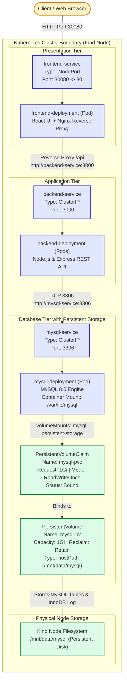

# PERSISTENT STORAGE EVALUATION (PV and PVC)
## Cloud Computing Lab Evaluation – Problem Statement 12
### Application: Student Management System (React + Node.js Express + MySQL)

---

## 1. Problem Statement
Deploy an application on Kubernetes that stores data on a **PersistentVolume (PV)** through a **PersistentVolumeClaim (PVC)**. Demonstrate that the database records remain available, consistent, and intact after the database Pod is deleted and automatically recreated by the Kubernetes Deployment controller.

---

## 2. Objective
- Integrate Kubernetes Persistent Storage (`PersistentVolume` and `PersistentVolumeClaim`) into the existing three-tier **Student Management System**.
- Ensure that the MySQL 8.0 database engine stores its operational data files (`/var/lib/mysql`) on durable, persistent storage.
- Demonstrate stateful durability under Pod destruction/failure scenarios without data loss.
- Preserve existing application architecture, microservice separation, REST API endpoints, database schemas, ConfigMaps, and Secrets.

---

## 3. Introduction to PersistentVolume (PV)
A **PersistentVolume (PV)** is a piece of storage in the Kubernetes cluster that has been provisioned by an administrator or dynamically provisioned using Storage Classes.
- **Cluster Resource**: PV is a resource in the cluster just like a Node is a cluster resource.
- **Independent Lifecycle**: PVs have a lifecycle independent of any individual Pod that uses the PV. Even if the Pod terminates, crashes, or is deleted, the PV remains intact.
- **Reclaim Policies**:
  - `Retain`: Retains all data when the PVC is deleted, allowing manual reclamation.
  - `Delete`: Deletes the backing storage volume when the PVC is released.
- In our Kind/local Kubernetes environment, `hostPath` is utilized to map storage from the node filesystem (`/mnt/data/mysql`) into the PV.

---

## 4. Introduction to PersistentVolumeClaim (PVC)
A **PersistentVolumeClaim (PVC)** is a request for storage by a user/workload.
- **Pod Abstraction**: PVC allows a Pod to consume abstract storage resources without needing to know the implementation details of the underlying physical storage (cloud disks, SAN, local directories).
- **Matching & Binding**: PVC specifies capacity (e.g., `1Gi`), access modes (`ReadWriteOnce`), and storage classes (`manual`). The Kubernetes Control Plane searches for a matching PV and binds them together in a 1-to-1 relationship.
- **Status Progression**: A PVC moves from `Pending` to `Bound` once matched to a suitable PV.

---

## 5. Architecture of Student Management System

### End-to-End Workflow & Storage Architecture Diagram



---

## 6. How PV and PVC Work Together
1. **Provisioning**: The cluster administrator declares a `PersistentVolume` (`mysql-pv`) specifying storage capacity (`1Gi`), `accessModes: [ReadWriteOnce]`, `storageClassName: manual`, and hostPath location (`/mnt/data/mysql`).
2. **Claiming**: The developer creates a `PersistentVolumeClaim` (`mysql-pvc`) requesting `1Gi` storage with matching `storageClassName: manual` and `accessModes: [ReadWriteOnce]`.
3. **Binding**: The Kubernetes Volume Controller watches for unbound claims, finds `mysql-pv`, checks that specifications match, and marks both PV and PVC as **`Bound`**.
4. **Mounting**: The MySQL Deployment declares `volumes` referring to `claimName: mysql-pvc`, and `volumeMounts` mounting that volume inside the MySQL container at `/var/lib/mysql`.
5. **Decoupling**: When the MySQL Pod is killed, the PVC and PV remain `Bound`. When the Deployment spins up a replacement Pod, it mounts the same PVC, regaining immediate access to existing databases and student tables.

---

## 7. Implementation Files and YAML Configurations

### A. PersistentVolume Manifest (`kubernetes/mysql-pv.yaml`)
```yaml
apiVersion: v1
kind: PersistentVolume
metadata:
  name: mysql-pv
  labels:
    type: local
    app: student-management
    tier: database
spec:
  storageClassName: manual
  capacity:
    storage: 1Gi
  accessModes:
    - ReadWriteOnce
  persistentVolumeReclaimPolicy: Retain
  hostPath:
    path: "/mnt/data/mysql"
    type: DirectoryOrCreate
```
- **Key Parameters Explained**:
  - `storageClassName: manual`: Explicitly binds to PVC with the same class name, avoiding collision with default dynamic storage classes.
  - `capacity.storage: 1Gi`: Allocates 1 Gigabyte of volume space.
  - `accessModes: ReadWriteOnce (RWO)`: The volume can be mounted as read-write by a single node.
  - `persistentVolumeReclaimPolicy: Retain`: Tells Kubernetes to keep the volume and physical data safe if the PVC is released.
  - `hostPath.type: DirectoryOrCreate`: If `/mnt/data/mysql` does not already exist on the Kind node, Kubernetes automatically creates it.

### B. PersistentVolumeClaim Manifest (`kubernetes/mysql-pvc.yaml`)
```yaml
apiVersion: v1
kind: PersistentVolumeClaim
metadata:
  name: mysql-pvc
  labels:
    app: student-management
    tier: database
spec:
  storageClassName: manual
  accessModes:
    - ReadWriteOnce
  resources:
    requests:
      storage: 1Gi
```
- **Key Parameters Explained**:
  - `storageClassName: manual`: Matches the `mysql-pv` class name.
  - `resources.requests.storage: 1Gi`: Requests 1Gi, which matches the capacity provided by `mysql-pv`.

### C. MySQL Deployment Manifest (`kubernetes/mysql-deployment.yaml`)
```yaml
apiVersion: apps/v1
kind: Deployment
metadata:
  name: mysql-deployment
  labels:
    app: student-management
    tier: database
spec:
  replicas: 1
  selector:
    matchLabels:
      app: student-management
      tier: database
  template:
    metadata:
      labels:
        app: student-management
        tier: database
    spec:
      containers:
        - name: mysql
          image: mysql:8.0
          imagePullPolicy: IfNotPresent
          ports:
            - containerPort: 3306
              name: mysql
          env:
            - name: MYSQL_ROOT_PASSWORD
              valueFrom:
                secretKeyRef:
                  name: mysql-secret
                  key: MYSQL_ROOT_PASSWORD
            - name: MYSQL_DATABASE
              valueFrom:
                configMapKeyRef:
                  name: app-configmap
                  key: DB_NAME
          volumeMounts:
            - name: mysql-persistent-storage
              mountPath: /var/lib/mysql
          startupProbe:
            exec:
              command:
                - bash
                - "-c"
                - "mysqladmin ping -h localhost -uroot -p$MYSQL_ROOT_PASSWORD"
            initialDelaySeconds: 15
            periodSeconds: 5
            timeoutSeconds: 3
            failureThreshold: 20
          readinessProbe:
            exec:
              command:
                - bash
                - "-c"
                - "mysqladmin ping -h localhost -uroot -p$MYSQL_ROOT_PASSWORD"
            initialDelaySeconds: 5
            periodSeconds: 5
            timeoutSeconds: 2
            failureThreshold: 3
          livenessProbe:
            exec:
              command:
                - bash
                - "-c"
                - "mysqladmin ping -h localhost -uroot -p$MYSQL_ROOT_PASSWORD"
            initialDelaySeconds: 20
            periodSeconds: 10
            timeoutSeconds: 2
            failureThreshold: 3
      volumes:
        - name: mysql-persistent-storage
          persistentVolumeClaim:
            claimName: mysql-pvc
```

---

## 8. Step-by-Step Execution and Verification Guide

### Step 1: Ensure Cluster Prerequisites
Make sure your Docker Desktop and Kind cluster are running:
```bash
docker ps
kubectl cluster-info
kubectl get nodes
```

### Step 2: Apply Storage and Configurations
```bash
# 1. ConfigMaps and Secrets
kubectl apply -f kubernetes/app-configmap.yaml
kubectl apply -f kubernetes/mysql-secret.yaml

# 2. Storage Layer (PV & PVC)
kubectl apply -f kubernetes/mysql-pv.yaml
kubectl apply -f kubernetes/mysql-pvc.yaml
```

### Step 3: Verify PV and PVC Binding
```bash
kubectl get pv
kubectl get pvc
```
**Expected Output:**
```
NAME       CAPACITY   ACCESS MODES   RECLAIM POLICY   STATUS   CLAIM               STORAGECLASS   AGE
mysql-pv   1Gi        RWO            Retain           Bound    default/mysql-pvc   manual         20s

NAME        STATUS   VOLUME     CAPACITY   ACCESS MODES   STORAGECLASS   AGE
mysql-pvc   Bound    mysql-pv   1Gi        RWO            manual         15s
```
Both `STATUS` columns must clearly show **`Bound`**.

### Step 4: Deploy Database, Backend, and Frontend Tiers
```bash
kubectl apply -f kubernetes/mysql-deployment.yaml
kubectl apply -f kubernetes/mysql-service.yaml

kubectl apply -f kubernetes/backend-deployment.yaml
kubectl apply -f kubernetes/backend-service.yaml

kubectl apply -f kubernetes/frontend-deployment.yaml
kubectl apply -f kubernetes/frontend-service.yaml
```

Wait until all Pods are Running:
```bash
kubectl get pods -w
```
**Expected Output:**
```
NAME                                   READY   STATUS    RESTARTS   AGE
backend-deployment-64d856b9c9-5q7x4   1/1     Running   0          45s
backend-deployment-64d856b9c9-k9v2p   1/1     Running   0          45s
frontend-deployment-559d7b8cb8-72t9b  1/1     Running   0          30s
mysql-deployment-7bb9d47979-w4mgl     1/1     Running   0          55s
```

---

## 9. Data Persistence Demonstration Test (Step-by-Step)

### Step 9.1: Access the Student Management System
Open the browser at:
```
http://localhost:30080
```
(Or use Node IP if running under custom Kind node port forwarding).

### Step 9.2: Insert a New Student Record
Click **Add Student** and fill in unique evaluation details:
- **Full Name**: `Deepak Kumar (PV Evaluation)`
- **USN**: `1MS21CS999`
- **Branch**: `Computer Science & Engineering`
- **Semester**: `6`
- **Email**: `deepak.pv@example.edu`

Click **Save Record**. The new student record appears instantly in the UI.

### Step 9.3: Verify Record Directly in MySQL Database
Retrieve the current MySQL Pod name and query the `students` table:
```bash
MYSQL_POD=$(kubectl get pod -l app=student-management,tier=database -o jsonpath="{.items[0].metadata.name}")
echo "Current MySQL Pod: $MYSQL_POD"

kubectl exec -it $MYSQL_POD -- mysql -uroot -pstudent_secure_password123 studentdb -e "SELECT id, name, usn, branch, semester, email FROM students WHERE usn='1MS21CS999';"
```
**Expected Output:**
```
+----+------------------------------+------------+----------------------------------+----------+-----------------------+
| id | name                         | usn        | branch                           | semester | email                 |
+----+------------------------------+------------+----------------------------------+----------+-----------------------+
|  5 | Deepak Kumar (PV Evaluation) | 1MS21CS999 | Computer Science & Engineering   |        6 | deepak.pv@example.edu |
+----+------------------------------+------------+----------------------------------+----------+-----------------------+
```

### Step 9.4: Delete the MySQL Pod (Simulating Pod Failure / Destruction)
```bash
kubectl delete pod $MYSQL_POD
```
**Expected Output:**
```
pod "mysql-deployment-7bb9d47979-w4mgl" deleted
```

### Step 9.5: Observe Kubernetes Self-Healing and Replacement
Watch the replacement Pod being scheduled and becoming ready:
```bash
kubectl get pods -l tier=database -w
```
**Expected Transition:**
```
NAME                                 READY   STATUS              RESTARTS   AGE
mysql-deployment-7bb9d47979-w4mgl   1/1     Terminating         0          3m
mysql-deployment-7bb9d47979-8xr2d   0/1     ContainerCreating   0          2s
mysql-deployment-7bb9d47979-8xr2d   1/1     Running             0          18s
```
Notice the Pod name changed from `...-w4mgl` to `...-8xr2d`.

### Step 9.6: Verify Data Persistence in the Replacement Pod
Query the replacement MySQL Pod:
```bash
NEW_MYSQL_POD=$(kubectl get pod -l app=student-management,tier=database -o jsonpath="{.items[0].metadata.name}")
echo "Replacement MySQL Pod: $NEW_MYSQL_POD"

kubectl exec -it $NEW_MYSQL_POD -- mysql -uroot -pstudent_secure_password123 studentdb -e "SELECT id, name, usn, branch, semester, email FROM students WHERE usn='1MS21CS999';"
```
**Verification Result:**
The record `1MS21CS999` is returned intact!

### Step 9.7: Verify via Web Application Frontend
1. Open or refresh `http://localhost:30080`.
2. Notice that the student `Deepak Kumar (PV Evaluation)` (`1MS21CS999`) is still displayed in the student list.
3. Try searching for `1MS21CS999` using the search box; it will return the record successfully.

---

## 10. Results and Conclusion
1. **Successful PV & PVC Creation**: `mysql-pv` and `mysql-pvc` were successfully bound with status `Bound`.
2. **Stateful Durability Verified**: After completely terminating the running MySQL Pod, the Kubernetes Deployment automatically created a replacement Pod.
3. **Zero Data Loss**: The replacement MySQL Pod remounted the existing Persistent Volume Claim at `/var/lib/mysql`. All existing databases, tables, and recently created student records survived intact.
4. **Decoupled Architecture**: Storage lifecycle is strictly decoupled from the transient compute (Pod) lifecycle, satisfying all requirements of Cloud Computing Lab Problem 12.

---

## 11. Lab Viva Questions and Answers

### Q1: What is the fundamental difference between a Pod volume (e.g., `emptyDir`) and a `PersistentVolume`?
**Answer**:
- An `emptyDir` volume is created when a Pod is assigned to a Node and exists only as long as that Pod is running on that node. If the Pod crashes, restarts, or is deleted, all data inside `emptyDir` is permanently deleted.
- A `PersistentVolume` (PV) has an independent lifecycle from the Pod. Even if the Pod is deleted, relocated to another node, or rescheduled, the PV and its underlying data remain completely safe and can be reattached to a new Pod.

### Q2: What are the different Access Modes available for a PersistentVolume?
**Answer**:
- **ReadWriteOnce (RWO)**: The volume can be mounted as read-write by a single Node.
- **ReadOnlyMany (ROX)**: The volume can be mounted as read-only by many Nodes simultaneously.
- **ReadWriteMany (RWX)**: The volume can be mounted as read-write by many Nodes simultaneously (common with NFS, Ceph, GlusterFS).
- **ReadWriteOncePod (RWOP)**: The volume can be mounted as read-write by a single Pod across the entire cluster (introduced in Kubernetes v1.22+).

### Q3: What is the purpose of `storageClassName` in PV and PVC?
**Answer**:
`storageClassName` allows administrators to categorize different profiles of storage (e.g., SSD vs. HDD, local vs. cloud) and facilitates matching. When a PVC requests `storageClassName: manual`, Kubernetes matches it only with a PV configured with `storageClassName: manual`. Setting it avoids accidental binding to default dynamic provisioners.

### Q4: What happens when a PVC bound to a PV with `persistentVolumeReclaimPolicy: Retain` is deleted?
**Answer**:
When the PVC is deleted, the PV is not deleted; instead, its status becomes `Released`. The data remains on the physical storage, but the PV cannot be bound to another PVC until an administrator manually reclaims or scrubs it.

### Q5: Why is hostPath storage appropriate for local clusters like Kind or Minikube, and how does it behave in multi-node clusters?
**Answer**:
`hostPath` mounts a file or directory from the host node’s filesystem into the Pod. In a single-node local environment like Kind or Minikube, it provides easy persistence without requiring external SAN/cloud disk drivers. In a multi-node cluster, however, if a Pod is rescheduled onto a different node, a simple `hostPath` volume on the previous node won't be accessible unless node affinity or distributed networked storage (like NFS or Ceph) is used.

### Q6: Why did we mount the storage at `/var/lib/mysql`?
**Answer**:
Official MySQL Docker images store all database files, tablespace files (`ibdata1`), InnoDB log files (`ib_logfile*`), and schemas inside the `/var/lib/mysql` directory. Mounting our PVC volume to this exact directory ensures all persistent writes by the MySQL engine are made directly to the backing PersistentVolume.
