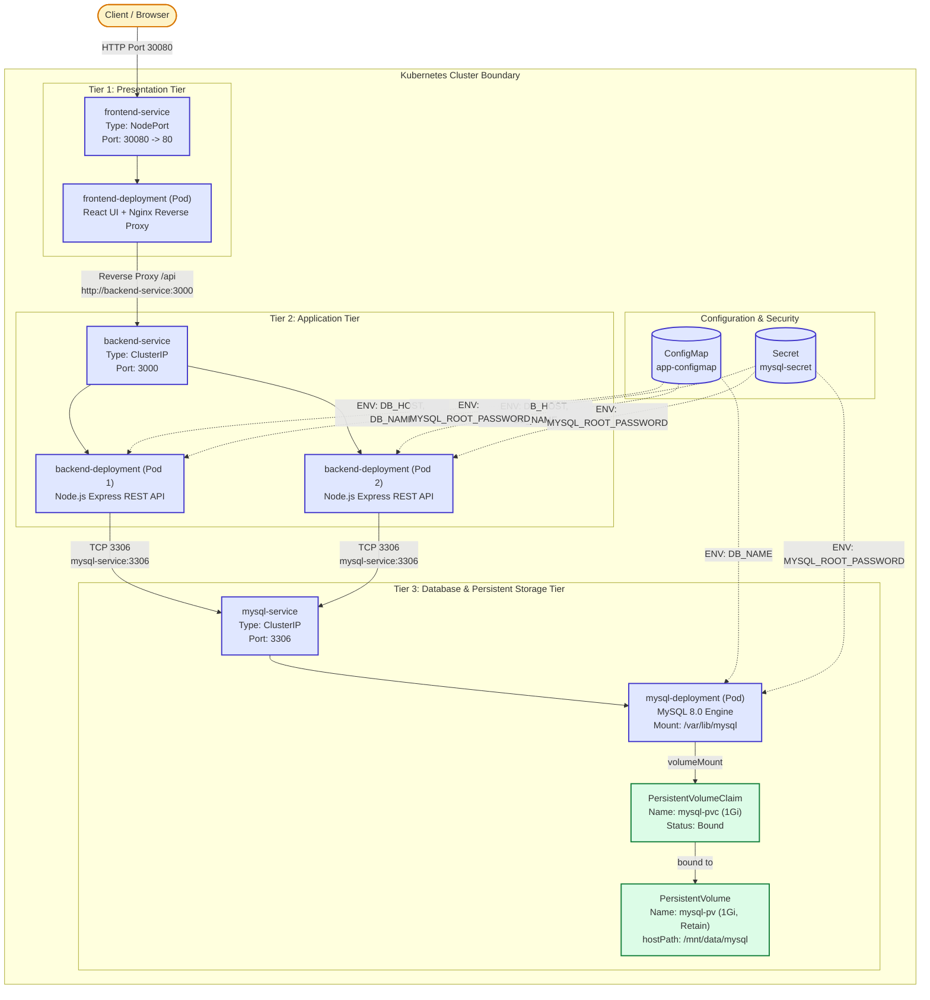

# Student Management System: Kubernetes Deployment & Persistent Storage (PV & PVC)

An enterprise-grade, three-tier cloud-native web application orchestrated on **Kubernetes (Kind / Minikube / Docker Desktop)**. This repository implements **Problem 12 – Persistent Storage Using PersistentVolumes (PV) and PersistentVolumeClaims (PVC)** and **Problem 19 – Multi-Tier Service Networking** for Cloud Computing Lab Evaluations.

---

## Table of Contents
1. [Project Overview](#project-overview)
2. [Three-Tier Architecture & Topology](#three-tier-architecture--topology)
3. [Kubernetes Storage Architecture (PV & PVC)](#kubernetes-storage-architecture-pv--pvc)
4. [Technology Stack](#technology-stack)
5. [Repository Structure](#repository-structure)
6. [Kubernetes Manifests Reference](#kubernetes-manifests-reference)
7. [Installation & Deployment Guide](#installation--deployment-guide)
8. [Data Persistence Demonstration (Lab Evaluation Test)](#data-persistence-demonstration-lab-evaluation-test)
9. [Teardown & Cleanup](#teardown--cleanup)
10. [Lab Evaluation Documentation & Viva Guide](#lab-evaluation-documentation--viva-guide)

---

## 1. Project Overview

The **Student Management System** is built to demonstrate modern container orchestration, decoupled microservice networking, and persistent stateful database storage in Kubernetes.

### Key Capabilities:
- **Full-featured CRUD Application**: Create, read, update, delete, and search student records via a modern responsive React UI.
- **Strict Tier Decoupling**: Browser communicates only with the frontend presentation layer. Nginx reverse-proxies `/api` routes internally via Kubernetes CoreDNS to `backend-service:3000`.
- **Database Isolation**: The MySQL database is internal and reachable only within the cluster (`mysql-service:3306`).
- **Resilient Stateful Storage**: Database tables and transaction logs persist in a Kubernetes `PersistentVolume` (`mysql-pv`) mapped through a `PersistentVolumeClaim` (`mysql-pvc`), guaranteeing **zero data loss** across Pod crashes, node rescheduling, or intentional Pod termination.

---

## 2. Three-Tier Architecture & Topology



---

## 3. Kubernetes Storage Architecture (PV & PVC)

In Kubernetes, standard container filesystems are ephemeral. If a container crashes or a Pod is deleted, changes to its local disk are permanently discarded.

To achieve ACID persistence for MySQL:
1. **PersistentVolume (`mysql-pv`)**: Represents 1Gi physical storage on the node filesystem (`/mnt/data/mysql`) with `storageClassName: manual` and `persistentVolumeReclaimPolicy: Retain`.
2. **PersistentVolumeClaim (`mysql-pvc`)**: Issues a request for 1Gi storage with `storageClassName: manual` and `ReadWriteOnce` access mode.
3. **Volume Binding**: The Kubernetes Volume Controller matches `mysql-pvc` to `mysql-pv` and marks both **`Bound`**.
4. **Pod Volume Mount**: `mysql-deployment` mounts `mysql-pvc` directly at `/var/lib/mysql` inside the container.
5. **Durability Guarantee**: Deleting or restarting the MySQL Pod leaves the PV and PVC intact. When the Deployment controller recreates the Pod, it remounts the existing storage, preserving all student tables and records.

---

## 4. Technology Stack

| Layer | Technology | Key Details |
| :--- | :--- | :--- |
| **Presentation Tier** | React 18, Vite, Lucide Icons, Nginx Alpine | Responsive UI with real-time health checks, CRUD forms, and `/api` reverse proxy |
| **Application Tier** | Node.js 20, Express, `mysql2` pool | RESTful API endpoints, request validation, graceful shutdown handlers |
| **Database Tier** | MySQL 8.0 Community Server | ACID transactions, utf8mb4 charset, custom healthcheck scripts |
| **Storage Layer** | Kubernetes PV & PVC (`hostPath`) | 1Gi persistent disk mounted at `/var/lib/mysql` with `Retain` policy |
| **Containerization** | Docker | Multi-stage Docker builds producing minimal Alpine-based images |
| **Orchestration** | Kubernetes (Kind / Minikube) | Self-healing Deployments, NodePort & ClusterIP Services, Probes |

---

## 5. Repository Structure

```
student-management-kubernetes/
├── frontend/
│   ├── src/
│   │   ├── App.jsx                 # Dashboard, CRUD modals, search & status cards
│   │   ├── index.css               # Styling, animations, responsive design
│   │   └── main.jsx                # React application entrypoint
│   ├── public/
│   ├── index.html                  # HTML entrypoint
│   ├── vite.config.js              # Vite bundler configuration
│   ├── nginx.conf                  # Nginx reverse proxy configuration (/api -> backend)
│   ├── Dockerfile                  # Multi-stage production container build
│   └── package.json
│
├── backend/
│   ├── src/
│   │   ├── db.js                   # Connection pooling, retry logic & table schema setup
│   │   └── server.js               # Express REST API, health & readiness endpoints
│   ├── Dockerfile                  # Production Node 20 Alpine container image
│   └── package.json
│
├── database/
│   └── init.sql                    # MySQL schema initialization and seed student data
│
├── kubernetes/
│   ├── app-configmap.yaml          # Non-confidential environment configuration (DB_HOST, DB_PORT)
│   ├── mysql-secret.yaml           # Database root credentials
│   ├── mysql-pv.yaml               # 1Gi PersistentVolume definition (hostPath: /mnt/data/mysql)
│   ├── mysql-pvc.yaml              # 1Gi PersistentVolumeClaim definition (storageClassName: manual)
│   ├── mysql-deployment.yaml       # MySQL 8.0 Deployment mounting mysql-pvc at /var/lib/mysql
│   ├── mysql-service.yaml          # ClusterIP service for MySQL (Port 3306)
│   ├── backend-deployment.yaml     # Express REST API Deployment (2 replicas + probes)
│   ├── backend-service.yaml        # ClusterIP service for backend (Port 3000)
│   ├── frontend-deployment.yaml    # React + Nginx Deployment (probes included)
│   └── frontend-service.yaml       # NodePort service for public browser access (Port 30080)
│
├── scripts/
│   ├── build.sh / build.ps1        # Container image build scripts
│   ├── deploy.sh / deploy.ps1      # Manifest application scripts
│   ├── test.sh                     # Automated evaluation and persistence test suite
│   └── cleanup.sh / cleanup.ps1    # Cluster teardown scripts
│
├── docker-compose.yml              # Local testing environment without Kubernetes
├── PERSISTENT_STORAGE_EVALUATION.md # Comprehensive lab evaluation report & viva guide
└── README.md                       # Main project documentation
```

---

## 6. Kubernetes Manifests Reference

### Storage Layer (PV & PVC)

#### `kubernetes/mysql-pv.yaml`
```yaml
apiVersion: v1
kind: PersistentVolume
metadata:
  name: mysql-pv
  labels:
    type: local
    app: student-management
    tier: database
spec:
  storageClassName: manual
  capacity:
    storage: 1Gi
  accessModes:
    - ReadWriteOnce
  persistentVolumeReclaimPolicy: Retain
  hostPath:
    path: "/mnt/data/mysql"
    type: DirectoryOrCreate
```

#### `kubernetes/mysql-pvc.yaml`
```yaml
apiVersion: v1
kind: PersistentVolumeClaim
metadata:
  name: mysql-pvc
  labels:
    app: student-management
    tier: database
spec:
  storageClassName: manual
  accessModes:
    - ReadWriteOnce
  resources:
    requests:
      storage: 1Gi
```

#### `kubernetes/mysql-deployment.yaml` (Storage Volume Mount Extract)
```yaml
      containers:
        - name: mysql
          image: mysql:8.0
          volumeMounts:
            - name: mysql-persistent-storage
              mountPath: /var/lib/mysql
      volumes:
        - name: mysql-persistent-storage
          persistentVolumeClaim:
            claimName: mysql-pvc
```

---

## 7. Installation & Deployment Guide

### Prerequisites
- [Docker Desktop](https://www.docker.com/products/docker-desktop/) or Docker Engine installed and running.
- [Kind](https://kind.sigs.k8s.io/) or [Minikube](https://minikube.sigs.k8s.io/).
- [kubectl](https://kubernetes.io/docs/tasks/tools/) command line tool.

### Step 1: Build Container Images
From the repository root:
```bash
# Build backend image
docker build -t student-backend:latest ./backend

# Build frontend image
docker build -t student-frontend:latest ./frontend
```
> If using **Kind**, load images into the cluster:
> ```bash
> kind load docker-image student-backend:latest
> kind load docker-image student-frontend:latest
> ```
> If using **Minikube**, load images via:
> ```bash
> minikube image load student-backend:latest
> minikube image load student-frontend:latest
> ```

### Step 2: Deploy to Kubernetes Cluster
Run the automated script:
```bash
# On Linux/macOS
./scripts/deploy.sh

# On Windows PowerShell
.\scripts\deploy.ps1
```

Or deploy manually in sequence:
```bash
# 1. ConfigMaps and Secrets
kubectl apply -f kubernetes/app-configmap.yaml
kubectl apply -f kubernetes/mysql-secret.yaml

# 2. Persistent Storage (PV & PVC)
kubectl apply -f kubernetes/mysql-pv.yaml
kubectl apply -f kubernetes/mysql-pvc.yaml

# 3. Database Tier
kubectl apply -f kubernetes/mysql-deployment.yaml
kubectl apply -f kubernetes/mysql-service.yaml

# 4. Backend Tier
kubectl apply -f kubernetes/backend-deployment.yaml
kubectl apply -f kubernetes/backend-service.yaml

# 5. Frontend Tier
kubectl apply -f kubernetes/frontend-deployment.yaml
kubectl apply -f kubernetes/frontend-service.yaml
```

### Step 3: Verify Deployment Status
```bash
kubectl get pv
kubectl get pvc
kubectl get pods -o wide
kubectl get svc
```
All Pods should reach `STATUS: Running` and both `mysql-pv` and `mysql-pvc` should show `STATUS: Bound`.

### Step 4: Access the Application
Open your browser at:
```
http://localhost:30080
```
*(If using Minikube without direct localhost port-forwarding, run `minikube service frontend-service` or navigate to `http://$(minikube ip):30080`).*

---

## 8. Data Persistence Demonstration (Lab Evaluation Test)

Follow this 7-step test to demonstrate database durability to the evaluator:

### Step 1: Add a Student via the Frontend
1. Open `http://localhost:30080`.
2. Click **Add Student** and submit a test record:
   - **Full Name**: `Deepak Kumar (PV Evaluation)`
   - **USN**: `1MS21CS999`
   - **Branch**: `Computer Science & Engineering`
   - **Semester**: `6`
   - **Email**: `deepak.pv@example.edu`
3. Verify that the student appears in the UI list.

### Step 2: Verify the Record Directly Inside MySQL
```bash
MYSQL_POD=$(kubectl get pod -l app=student-management,tier=database -o jsonpath="{.items[0].metadata.name}")
echo "Current MySQL Pod: $MYSQL_POD"

kubectl exec -it $MYSQL_POD -- mysql -uroot -pstudent_secure_password123 studentdb -e "SELECT id, name, usn, branch, semester, email FROM students WHERE usn='1MS21CS999';"
```

### Step 3: Check Storage Status as Bound
```bash
kubectl get pv mysql-pv
kubectl get pvc mysql-pvc
```
Both resources will clearly show `STATUS: Bound`.

### Step 4: Delete the MySQL Pod
Simulate a catastrophic pod crash or deletion:
```bash
kubectl delete pod $MYSQL_POD
```

### Step 5: Observe Kubernetes Self-Healing
```bash
kubectl get pods -l tier=database -w
```
Kubernetes Deployment detects the terminated Pod and immediately schedules and starts a replacement Pod with a new name.

### Step 6: Query Replacement Pod Directly
```bash
NEW_MYSQL_POD=$(kubectl get pod -l app=student-management,tier=database -o jsonpath="{.items[0].metadata.name}")
echo "Replacement MySQL Pod: $NEW_MYSQL_POD"

kubectl exec -it $NEW_MYSQL_POD -- mysql -uroot -pstudent_secure_password123 studentdb -e "SELECT id, name, usn, branch, semester, email FROM students WHERE usn='1MS21CS999';"
```
**Result**: The record `1MS21CS999` is returned intact!

### Step 7: Verify Through the Frontend UI
Refresh `http://localhost:30080`. Student `1MS21CS999` remains present and functional in the system, proving full database persistence.

---

## 9. Teardown & Cleanup

To delete all deployed resources:
```bash
# On Linux/macOS
./scripts/cleanup.sh

# On Windows PowerShell
.\scripts\cleanup.ps1
```

---

## 10. Lab Evaluation Documentation & Viva Guide

For complete lab submission documentation, detailed theoretical explanations, and high-scoring viva questions & answers, refer to:
📄 **[PERSISTENT_STORAGE_EVALUATION.md](PERSISTENT_STORAGE_EVALUATION.md)**
